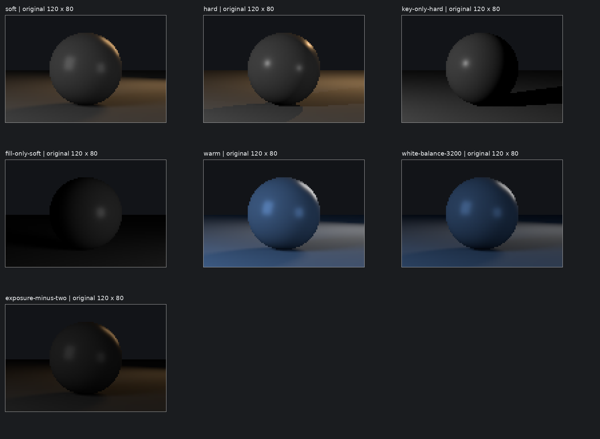
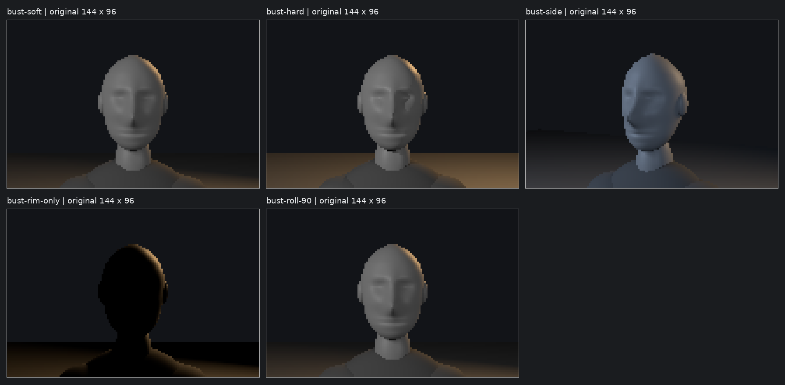

# Current-source synthetic rendering review

Rendered source: `c19d5f8f9cae6bb88660e86954212cfb201cd84e`.
Original GitHub artifact: `15230446898`, retained byte-for-byte in
[checkpoint-02-core-original.zip](../checkpoint-02-core-original.zip).

Worker 057 independently verified the artifact and all twelve PPM/scene hashes,
checked the declared scene relationships, and actually viewed every output. The
[original review receipt](receipt.json) records each observation and its original
analysis path. The integration lead also viewed both contact sheets below.

These sheets enlarge original pixels with nearest-neighbor scaling and add
labels outside the image regions. They do not synthesize or retouch output.
All twelve images retain complete geometry, expected hard/soft shadow changes,
color/exposure differences and zero unsupported pixels at their declared small
resolutions. The hard sphere has two red-channel endpoint samples at 255 in the
rim; this is recorded explicitly, without broad highlight clipping or a new
visible defect. The rim-only mannequin is intentionally mostly dark.

This accepts the inspected synthetic CPU outputs within their code-fixture scope.
It does not establish photographic fidelity, skin exposure, native Metal parity,
physical performance or device calibration.

## Sphere fixtures

## Mannequin fixtures

