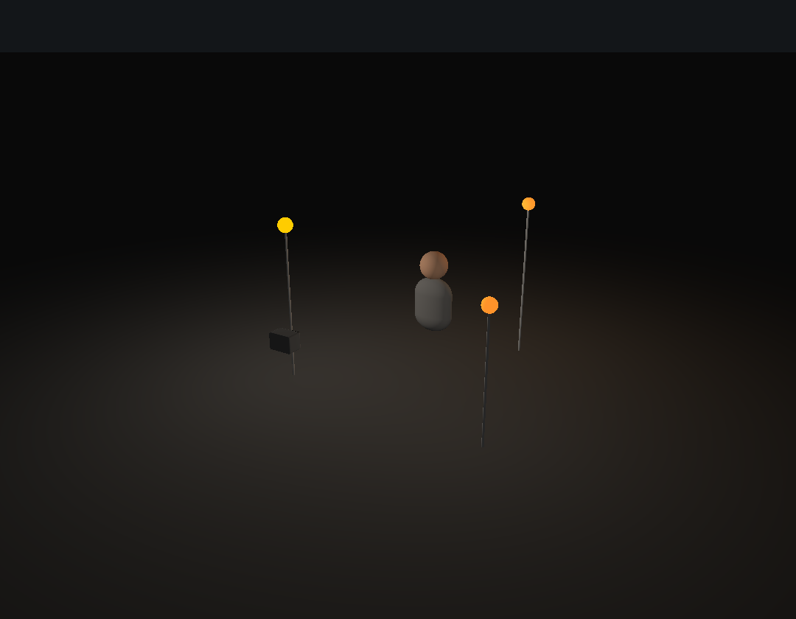
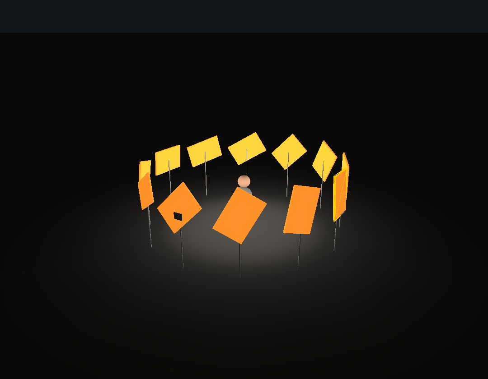

# Lane 05 handoff — native spatial viewports

## Status

Branch: `finish/05-spatial-viewports`. Campaign baseline: `f150f98e35dd735927075aac4d2f8b02295c6a67`.

Latest production/native-test source: `60059a0b8c5f099efb3fb5fffb3a1b8fee1df45a`. Later checkpoints contain documentation only unless their receipt says otherwise. The latest source passed **185 / 185 native methods, including all 39 spatial methods**, with exact one-start/one-pass accounting and no failures, skips, duplicates or omissions. Core, simulator test-bundle and Release builds passed. The overall CI run also contains export, library, optics and accessibility UI failures; it is not all green. See [the exact-source receipt](validation/NATIVE-60059a0.md).

**All 100 distinct fresh worker contexts are complete across ten waves**, with the aggregate ledger, every retained report hash and final-wave manifest verified. Root and followups are not counted. No milestone is promoted.

## Delivered behavior

### Navigation and Fit

RealityKit orbit, pan and pinch now operate on bounded, finite camera state in Double until native upload. One-finger drag orbits, two-finger drag pans in the camera plane, and pinch changes distance. Pan sensitivity follows the smaller viewport dimension. Invalid samples cannot poison navigation. Ordinary updates and layout changes retain the user's orbit; explicit Fit intentionally resets it.

Fit now uses the full represented-equipment envelope. The old Core-only bounds could omit a visible large housing with coincident aim, a high stand's floor base, or the aim-target sphere. The App-only helper adds housings and outlines, bust, camera body/lens, stands and marker volume while retaining Core's existing contract. The floor/grid are outside equipment Fit.

The fitted sphere uses a 48-degree smaller-axis field of view and 12% distance margin. SceneKit selects the corresponding projection axis when layout changes. RealityKit's vertical angle is rounded outward at the Float upload boundary so it cannot become narrower than the angle used by Fit; singular projections are rejected. The new regression targets an extreme subpixel aspect-ratio counterexample, not a claimed ordinary-layout rendering failure.

### Stable scene updates and selection

Continuing UUIDs retain their fixture, source, outline and stand nodes. Metadata, output and pose edits reuse geometry. Kind or rectangle-size edits replace shape resources while retaining equipment identity. Name-only RealityKit edits avoid unnecessary emission/material replacement.

Selection callbacks refresh even when the scene values are identical. Invalid scenes and deletion discard old equipment ownership and hit maps. Resolution checks current ancestry, visibility and live membership. A retained hit from a removed fixture cannot select newly introduced equipment that happens to reuse its UUID. Project replacement also depends on the parent identity/generation guards.

Adapters suspend interactions when disabled, inactive or detached. Teardown disconnects gestures, targets, delegates, callbacks and the view’s scene attachments. SceneKit clears its per-lamp maps while retaining the coordinator’s two fixed nodes. RealityKit can retain graph objects and resolve their IDs while that coordinator remains alive; detached handler and callback gates prevent delivery. These checks establish bounded state and interaction behavior, not ARC/GPU deallocation or sustained frame rate.

### Authored geometry and camera view

Meter units and the right-handed Core frame remain unchanged. Fixture fronts are anchored at the authored emitter plane; roll and deterministic vertical aim use the complete Core basis. Native emitter objects account for their local negative-Z emission convention without changing the authored positive-Z frame. Camera bodies and lenses follow local negative Z.

RealityKit rectangle faces now use the full authored width and height. The former 6 mm inset at every edge made a 1.2 × 0.7 m face about 2.697% smaller in area, and a valid 0.05 × 0.05 m face 42.24% smaller. These are source/scalar comparisons, not measured RealityKit photometry.

Undefined aim keeps a selectable, world-aligned non-emitting housing. Recovery restores the aimed source without replacing the continuing fixture. Undefined camera view hides the prior point of view and explains recovery. A Camera → invalid Orbit → valid Orbit transition now applies the pending Fit instead of incorrectly consuming the mode transition.

### SceneKit fallback

On the available Intel iOS simulator target, the wrapper selects SceneKit before constructing RealityKit. The baseline runtime traps in CoreRE during initial mesh creation; a functioning Metal compute device alone did not establish RealityKit support.

The fallback uses incremental nodes, authored camera/lens framing, current hit ownership and explicit Fit. It was executed on the actual x86_64 iPhone 17 Pro / iOS 26.5 simulator with Xcode 26.6. RealityKit compiles in the native target but has not been exercised on a supported device/runtime in this campaign.

## Verification and captures

| Source | Native / spatial | Evidence |
|---|---:|---|
| `68c83cca` | 171 / 25 passed | [Native receipt](validation/NATIVE-68c83.md) |
| `9725fb1` | 176 / 30 passed | [Native receipt](validation/NATIVE-9725fb1.md) |
| `4e694bc` | 184 / 38 passed | [Native receipt](validation/NATIVE-4e694bc.md), exact method accounting and original captures |
| `60059a0` | 185 / 39 passed | [Exact-source receipt](validation/NATIVE-60059a0.md); core 366 Debug / 366 Release / 100 tooling passed |

Each completed native receipt requires exactly one ordered start/pass for every expected method, with no missing, failed, skipped or duplicate methods. Source-specific success is not transferred to later changed source. The added Float regression has now executed and passed at source 60059. The simulator warm-up diagnostic failed before the successful native run; that sequence is retained in the receipt.

The 39 spatial declarations comprise 11 arithmetic/state tests and 28 direct SceneKit behavior tests. Existing emitter tests supply five of the direct tests. The campaign adds 31 spatial methods to the baseline's eight. See [interaction regressions](INTERACTION_REGRESSIONS.md) and [geometry comparisons](GEOMETRY_COMPARISONS.md).

Native projection coverage includes **26 discrete projected points**, not 26 layouts. The portable wave-08 witness checks 15 scenes, 760 represented primitive instances and 240 modeled frustum cases per projection model. Portable calculations do not execute native camera matrices, quaternion conversion, mesh tessellation or rasterization.

### Original native captures

These are original SCNView snapshots in UIWindow during native XCTest. Their archive, source/run/test metadata and exact hashes are retained in [the capture receipt](captures/receipt-60059a0.json). The current native images are byte-identical to the earlier 4e originals, with distinct current-run attachment metadata.

Both rigs fit within the viewport. The crowded rig's foreground panels occlude parts of the subject and other fixtures; the selected right-hand rectangle remains outlined. Dark floor/stand contrast and the small camera symbol remain visual limitations. The captures do not establish full-app gesture delivery, physical-device behavior or manual VoiceOver acceptance.

### Integrated Fit action at the current source

The existing UI smoke method opens 3D, taps Fit, checks the selected 3D mode and captures the actual app. It passed at source 60059. See the [original full-app capture](captures/full-app-fit-feet-60059a0.png) and [exact receipt](captures/receipt-full-app-60059a0.json). This establishes the integrated Fit action and selected-tab continuity, without asserting camera pose or delivered orbit/pan/pinch. Its containing export shard is 9 passed / 1 failed.

The native disable/dismantle fixture checks view flags and teardown/maps. Because it lacks an onSelect callback and UIWindow, its negative delegate assertion does not independently isolate every disabled/offwindow predicate. Inactive/offwindow/VoiceOver delivery gates remain source-reviewed.

### Final broader UI status

| Shard | Recorded outcome | Evidence boundary |
|---|---|---|
| Studio export | 9 passed / 1 failed | Reopening the export chooser failed; the separate full-app Fit method passed. |
| Studio optics | 8 passed / 2 failed | Startup/status and emitter-query timeouts; the step also reached its40-minute limit. |
| App accessibility | 0 passed / 1 failed | Plan openMeter reachability; no full accessibility acceptance. |
| Library/reference | 3 passed / 1 failed / 1 unfinished / 4 unstarted | Large-library Saved locally wait failed, followed by a32-minute step timeout. |
| Room precision | In progress at final cutoff | No pass inferred; live run and timestamped job receipt remain available. |

These late library/room observations follow the sealed worker-report cutoffs. Exact raw logs, strict method accounting and owner triage are retained. No failing assertion or timeout was relaxed.

## Integration and ownership

Lane 05 changed four App files and seven native-test files relative to inherited main, plus this lane's evidence. No Core, composition, Plan, AR, Study or CI implementation is authored here.

The branch retains main `9e0e2ba` as an earlier parent, including its explicit-`CGFloat` test compilation repair and historical canonical/evidence updates. All 230 changed paths outside App, NativeTests and this lane's documentation match that parent by Git blob identity. See [scope provenance](validation/INTEGRATION_SCOPE-4e694bc.json). These are inherited changes, not lane-05-authored milestone decisions.

**Composition dependency:** lane 01 source `5ccfbaae821a32d88c12ed8b3abf1600aef25753` implements `.id(session.workspaceResetID)` while retaining captured-generation/live-UUID guards. Its tests assert first-save identity retention and project-create reset. Root confirmed the same identity/guards at owner revision `7bdea15c771d7dfeeb3f20d011b3c02e4bc5b34f`; the session and test blobs are unchanged. Lane 05 still contains inherited `.id(generation)`; first save can recreate the coordinator. Integrate the owner change and verify hosted/native viewport retention plus deliberate project replacement. No lane 01 source is merged here.

Lane 06 owns Core geometry; this lane consumes its frames and extends display bounds only in App. No published finish/06 or finish/20 branch was available at the recorded checks, so the requested default baseline remains in use. See [current owner requests](OWNER_REQUESTS.md) for exact pins, dispositions and historical UI failures.

## Remaining acceptance boundaries

- Integrate lane 01's presentation identity and check first-save retention / replacement with overlapping UUIDs.
- Exercise RealityKit on a supported runtime/device, including delivered orbit/pan/pinch/tap gestures and parent-scroll arbitration.
- Check manual VoiceOver, maximum Dynamic Type and SceneKit camera-control behavior with assistive technology. Accessible equipment-list actions exist, but source review is not manual acceptance.
- Observe extreme SceneKit free-camera navigation, first-hit occlusion behavior and resource usage on device if these become release gates. The bounded RealityKit far-clip proof does not apply to SceneKit's free camera controller.
- Reconcile current export-chooser, large-library save-status, optics-query and Plan openMeter accessibility UI failures through the owning lanes. No viewport cause is established. Other job dispositions are recorded in validation/run-60059a0-jobs.json; the whole workflow is not reported as passing. Earlier failures and cancellations remain preserved.

No device, thermal, frame-rate, measured leak or photometric-calibration claim is made. Acceptance thresholds and canonical milestone status remain unchanged by this lane.

## Worker and recovery record

[WORKER_LEDGER.json](WORKER_LEDGER.json) records actual canonical context IDs, input revisions, roles, report hashes and dispositions. Each wave is one fresh acceptance lead plus nine fresh specialists; root and followups are not counted. Root, lead and at most two children respect the four available concurrency slots. Writers use private temporary worktrees and writable outputs; read-only workers use pinned reads.

The 2,000-token brief / 12,000-token worker / 800-token report / 24,000-token coordinator numbers are planning targets. Token telemetry/enforcement is unavailable; no measured compliance or measured 60% token claim is made. [CHECKPOINT-60.md](CHECKPOINT-60.md) records the explicit planning checkpoint after six waves.

Four executor interruptions were recovered from preserved Git objects, exact report text and hashes. Wave 01's full original reports were lost before publication; its actual context IDs and recovered summaries are retained and labeled. Later reconstruction and native/portable distinctions are explicit in [RECOVERY.md](RECOVERY.md). No lost or unavailable execution is counted as a pass. The final audit also corrected one embedded body-only hash label in a wave-08 report; the original file and its matching whole-file ledger/manifest hashes remain intact. See `validation/worker-evidence-erratum.json`.

Source, all ten wave bundles, captures, failures and the completed ledger are preserved on the requested branch. [FINAL_VERIFICATION.json](validation/FINAL_VERIFICATION.json) records exact source equality to the tested revision, four owned App files/seven native-test files, inherited-scope checks and the verified 100-context ledger. Final publication verifies the remote commit and matching tree; temporary source work is preserved before cleanup.
