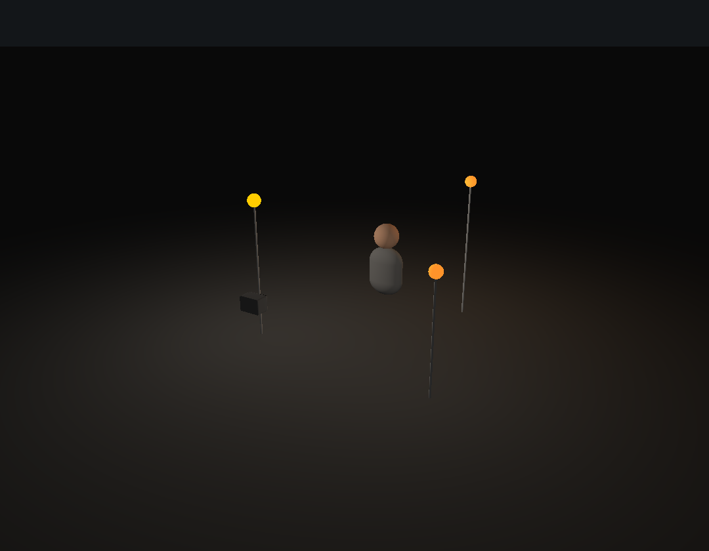
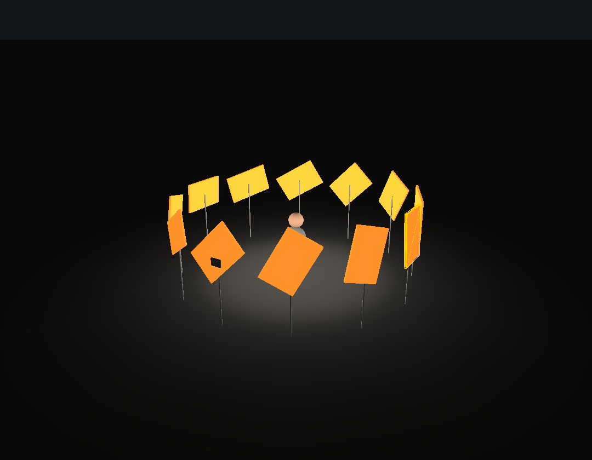

# Native checkpoint: 4e694bc

Source: `4e694bc377c4825d1d2dd52fcd7900e534c75072`.

[Workflow45838950713](https://github.com/mirzotipi-wq/APP1/actions/runs/45838950713), simulator job139980771221, completed successfully. Its exact decoded log is `native-4e694bc.log` (SHA256 `b538e299ef327f66ae9307d1f8c590bc178ff5782fafd6b04e801668961281ed`).

## Results

- **184 native methods passed**, with exactly one ordered start/pass per method and no failures, skips, duplicates or omissions.
- **38 spatial methods passed**. Individual pass lines are retained in `spatial-methods-4e694bc.json`.
- Debug test-bundle and unsigned Release simulator builds passed.
- Core job139978271046 passed366Debug/366Release package methods and100tooling checks. Its exact log is `core-4e694bc.log`.
- Actual runtime: x86_64 iPhone17Pro simulator with iOS26.5, Xcode26.6. The app selects SceneKit before RealityKit construction on this target.

| Spatial class | Passed |
|---|---:|
| SpatialAimRecoveryTests | 1 |
| SpatialEmitterGeometryTests | 5 |
| SpatialEntityUpdateTests | 3 |
| SpatialInteractionTests | 9 |
| SpatialNavigationRecoveryTests | 4 |
| SpatialPreviewTests | 3 |
| SpatialSelectionLifetimeTests | 3 |
| SpatialViewportStateTests | 10 |
| **Total** | **38** |

This closes execution of the eight methods added after9725: four navigation recovery methods, three selection-lifetime methods and one translated emitter recovery method. The ten state/helper methods run Swift camera/bounds arithmetic; the other28 directly exercise SceneKit behavior. Tests cover invalid-mode recovery, retained user camera/target, empty-rig availability, unchanged-scene callback replacement/clearing, deletion and invalid-scene identity lifetime, and coincident-to-valid emitter recovery.

## Original captures

Artifact15133365346, `native-unit-and-build-evidence-compact`, was downloaded and its ZIP SHA256 verified as `9ae832b001ec38c9f5cd5a316835d3c1036430ed832b7ddd1f563c15e02cc79f`. Original attachments and source/run/test metadata are retained in `../captures/receipt-4e694bc.json`.

Both originals were visually inspected and also match the9725PNG bytes exactly. The ordinary and crowded rigs fit within the frame; crowded modifiers occlude part of the bust, and the selected outline is visible at the right. The floor and small camera symbol retain limited contrast. These are real SCNView snapshots in UIWindow during XCTest, not full-app gesture delivery, RealityKit, physical-device or manualVoiceOver evidence.

## Other jobs and next candidate

Studio-optics, studio-export and room-precision UI shards completed successfully. Library-reference, app-accessibility and visual review were cancelled by successor source60059 after native execution had finished. These cancellations are not passes or established viewport failures. Exact final dispositions are preserved in run-4e694bc-final-jobs.json.

The independently reviewed following candidate rounds the RealityKit orbit field of view outward at the Float boundary and adds one focused state regression. That candidate has185native/39spatial methods and is outside this source SHA. This184-method execution must not be transferred to it. RealityKit source compilation does not establish RealityKit runtime behavior.
