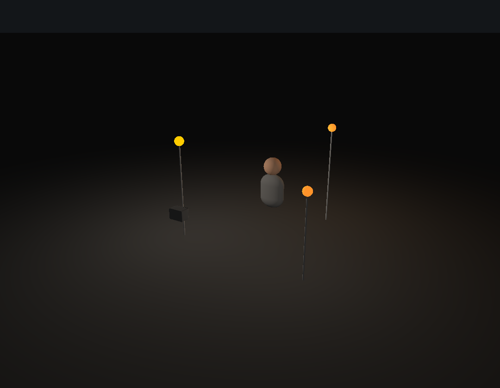
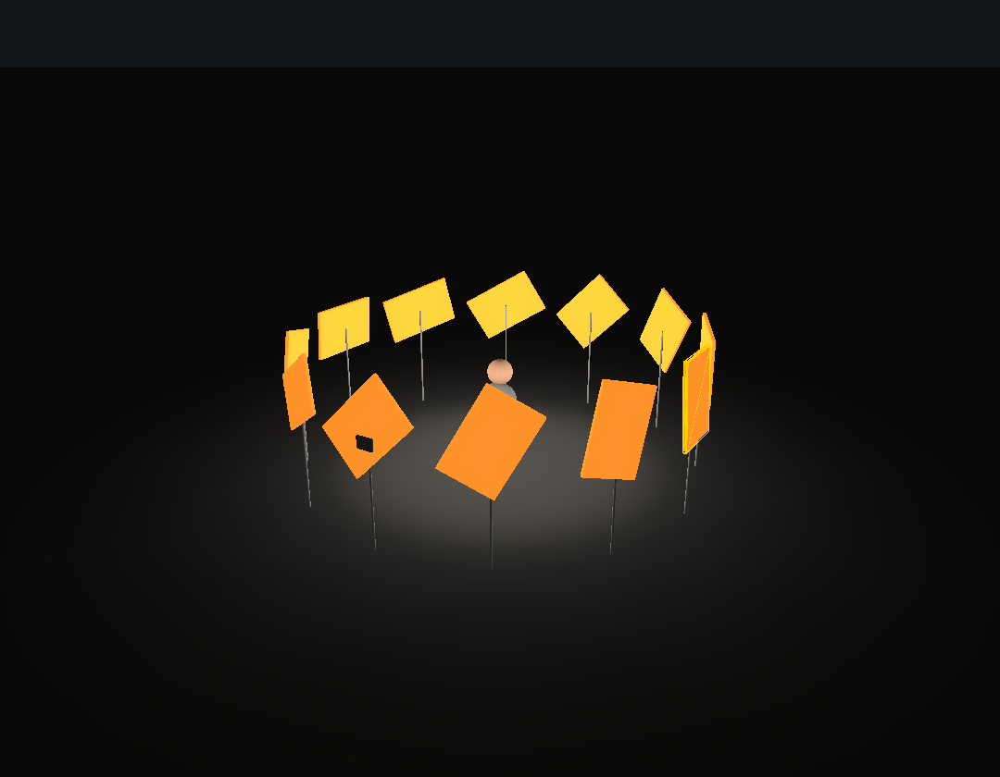

# Native checkpoint: 60059a0

Source: `60059a0b8c5f099efb3fb5fffb3a1b8fee1df45a`.

[Workflow 45851365897](https://github.com/mirzotipi-wq/APP1/actions/runs/45851365897), simulator job **140022794410**, completed **successfully**, confirmed at 2026-11-26 16:52:09 UTC. The overall workflow also contains failed UI shards and is not an all-green result.

## Exact results

- **185 / 185 native methods passed**, each with exactly one ordered start/pass, with no failures, skips, duplicates, unexpected methods or omissions.
- **39 / 39 spatial methods passed:** 11 arithmetic/state methods and 28 direct SceneKit methods.
- The new `testFloatProjectionDoesNotNarrowTheSmallerViewportAxis` method executed and passed at this source.
- Debug simulator app/test-bundle and unsigned Release app builds passed.
- Core job **140020330561** passed 366 Debug, 366 Release and 100 tooling checks. Exact log: `core-60059a0.log`, SHA256 `b5011f9a7c14437d78db6330b1bcfdf0775dc4c130dfd0af8f19d4a1946e7622`.
- Actual host: macOS 26.6.1, x86_64; Xcode 26.6, build 17F113. Selected runtime/device: iPhone 17 Pro / iOS 26.5, UDID `12FCFD0F-7FCF-463F-A605-132A7E18B5D5`. This target selects SceneKit before RealityKit construction.

The simulator warm-up diagnostic failed. The existing workflow labels that diagnostic as non-gating; the subsequent xcodebuild invocation actually ran all 185 methods, completed successfully and finalized its result bundle. This receipt preserves the diagnostic failure rather than converting it into a pass.

| Spatial class | Passed |
|---|---:|
| SpatialAimRecoveryTests | 1 |
| SpatialEmitterGeometryTests | 5 |
| SpatialEntityUpdateTests | 3 |
| SpatialInteractionTests | 9 |
| SpatialNavigationRecoveryTests | 4 |
| SpatialPreviewTests | 3 |
| SpatialSelectionLifetimeTests | 3 |
| SpatialViewportStateTests | 11 |
| **Total** | **39** |

## Independent accounting and provenance

The exact decoded job log is `native-60059a0.log`: **1,017,622 bytes**, SHA256 `b58df7f15f536e33ea439b00620aa0c75ef64dd785115195b1238cce28d4cfc8`, Git blob `86a3c24b5d7b7139fad00975b8953d6f977db74d`.

The complete contiguous native command output is retained as `native-60059a0-unit-output.log`, SHA256 `fd479f5d00938826f910f63f6a56ba59e08f0ba765fe752b991d03105de44913`. It contains raw job lines 4822–5750: from the actual diagnostic result through the line before the following accounting step. There is no filtering of test events. This interval excludes GitHub's earlier echoed shell/Python program, whose literal regular-expression text is not XCTest output. The extraction boundaries and hashes are recorded in `native-60059a0-extraction.json`.

Root ran the repository's unchanged verifier against that interval and the unchanged current-source inventory:

```sh
python3 scripts/native_test_shards.py verify-log unit \
  docs/parallel/05/validation/native-60059a0-unit-output.log \
  --report docs/parallel/05/validation/native-60059a0-accounting.json
```

The report records the complete expected, started and passed method sets. `spatial-methods-60059a0.json` retains all 39 spatial pass lines from the full raw log. Wave 10's platform reviewer independently verified the hashes, exact extraction, expected inventory and all ordered events.

## Original native captures

Artifact **15139140392**, `native-unit-and-build-evidence-compact`, is 641,197 bytes. Root downloaded it and verified ZIP SHA256 `172881c6ff31efd0e343acb7cddd3d5da8b9f475220a32a70db88601d1965fe8`.

The original ordinary and crowded PNGs, their source/run/test/device metadata and hashes are retained in [the capture receipt](../captures/receipt-60059a0.json). Both 1080 × 840 images exactly match the previously reviewed 4e PNG bytes, with distinct current-run attachment metadata. Wave 10 acceptance directly viewed the current originals.





These are SCNView snapshots in UIWindow during XCTest. Both rigs fit. Crowded foreground modifiers occlude part of the subject and other equipment; the selected right rectangle remains outlined. Dark floor/stands and the small camera symbol retain limited contrast.

## Separate full-app Fit evidence

The existing `StudioSmokeTests.testSettingsFeet3DFitAndSimulatorARManualFallback` method also passed at this source in UI job **140022794554**; its pass is at raw export-log line 2959. It opens 3D, taps Fit, asserts that 3D remains selected, and captures the full app. The original [full-app Fit capture](../captures/full-app-fit-feet-60059a0.png) and [its receipt](../captures/receipt-full-app-60059a0.json) are retained. The method also checks selected-tab continuity through later modal flows.

That is actual integrated Fit-action evidence. It does not assert the resulting camera pose or deliver orbit, pan or pinch gestures. The containing UI shard passed nine methods and failed a separate export-chooser method; the shard is not a pass. Its full evidence upload timed out, while its compact evidence archive uploaded successfully and was verified.

## Other jobs and limits

See `run-60059a0-jobs.json` for the latest timestamped dispositions. At the native terminal observation, export and app-accessibility UI shards had failed; library was still running, optics was finishing and room was queued.

The export failure waits for the format chooser when reopening after undo. The accessibility failure reports unreachable `openMeter` content at line 340 in the Plan workflow before any 3D/Camera stage. Exact failure logs and accounting are preserved. Product/harness causes remain unassigned; no viewport cause or full accessibility pass is inferred.

RealityKit source compilation and arithmetic tests do not establish RealityKit runtime rendering. Direct SceneKit tests, the full-app Fit action and original captures remain distinct from delivered orbit/pan/pinch, first-save viewport retention, physical-device testing, manual VoiceOver, measured frame rate, thermal behavior or ARC/GPU deallocation.

Later observation: the optics UI shard also failed. Repeatability03 timed out on startup status, Repeatability05 timed out querying emitterKind, and the step reached its40-minute timeout without a finalized XCTest bundle. Its exact raw log, accounting and triage are preserved as ui-studio-optics-60059a0*. No viewport cause is established.

Final handoff cutoff: library/reference also failed (3passed,1failed,1unfinished,4unstarted), with a large-library save-status wait and32-minute step timeout. Room precision remains in progress. These later statuses do not change the successful native185/39 execution or the earlier sealed worker observations. See run-60059a0-jobs.json for the exact timestamp.
