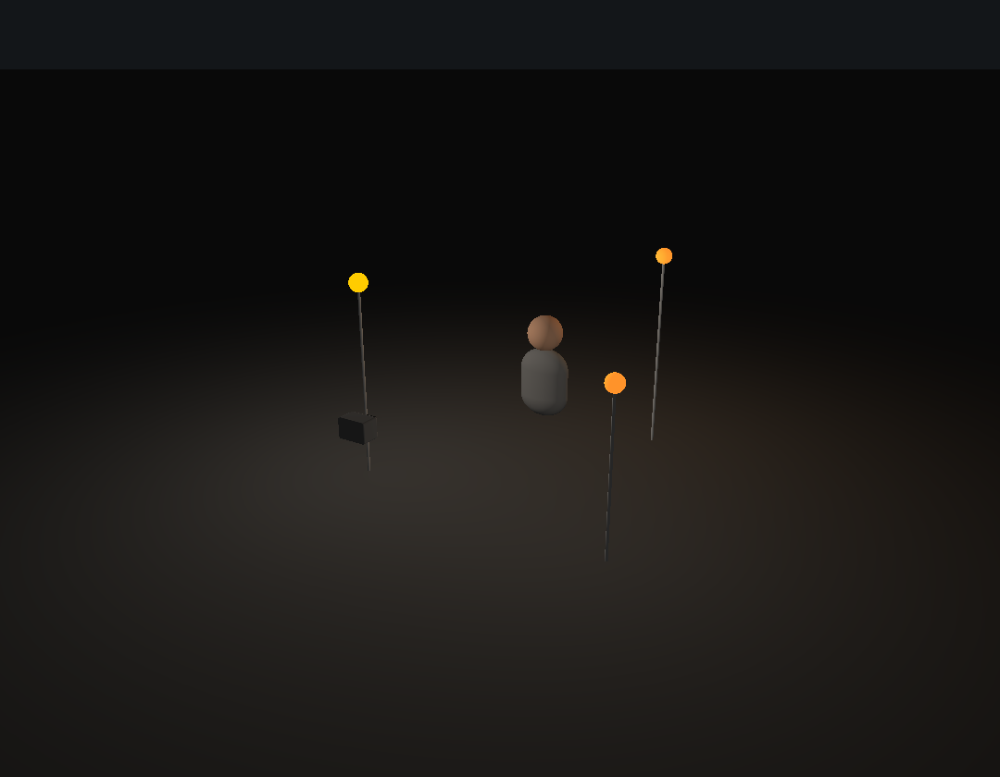
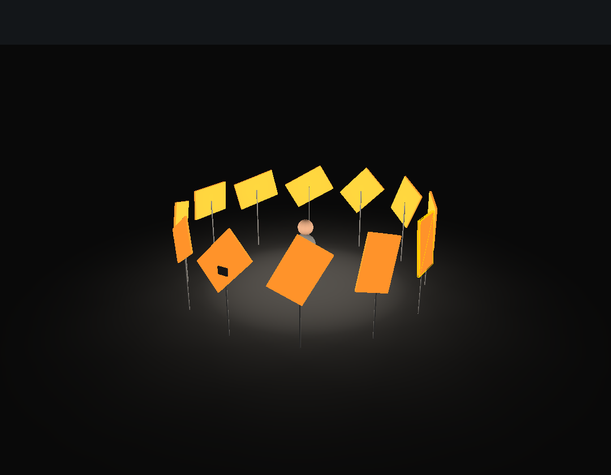

# Native checkpoint: 68c83

Source: `68c83cca75f9ef8fd41fe6a33358b00e0790c45a`.

[Workflow run 45817222487](https://github.com/mirzotipi-wq/APP1/actions/runs/45817222487), simulator job `139901927197`, completed successfully. The raw job log is `native-68c83.log`.

- Unsigned Debug test-bundle and Release app builds passed.
- 171 native tests passed, zero failed, zero skipped. Required Metal methods executed.
- All 25 spatial tests passed: 8 SpatialViewportStateTests, 9 SpatialInteractionTests, 3 SpatialPreviewTests, 5 SpatialEmitterGeometryTests.
- The native runtime was the x86_64 iOS simulator. Its unsupported RealityKit configuration uses the existing SceneKit fallback before constructing a RealityKit graph. RealityKit code compiled but was not exercised by these tests.
- The capture test produced two original PNGs. The artifact archive SHA256 was verified before extraction, and both originals were visually inspected. All fixture extents remain within each image. The crowded rig naturally obscures portions of the bust; the selected emitter outline is visible at right. Floor contrast and the small camera body remain visual limitations.

These are SCNView snapshots attached by XCTest in a UIWindow, not whole-app UI automation captures or evidence of manual gestures, VoiceOver, physical-device performance, or RealityKit rendering. Provenance and image digests are in `../captures/receipt-68c83.json`.

## Other results from the same run

Core passed 366 Debug and 366 Release package tests plus 100 tooling checks. Studio-optics UI initialization failed with an AX-loaded notification timeout. App-accessibility failed to reach light-Key in Plan mode. Other UI shards were still in progress when this receipt was written. Those results do not turn into passes because the native spatial tests passed. Owner requests retain the unresolved paths.

The later clipping, aim-marker-bound, extreme-aspect and incremental transition regressions are not covered by this source SHA. They require a later receipt.
