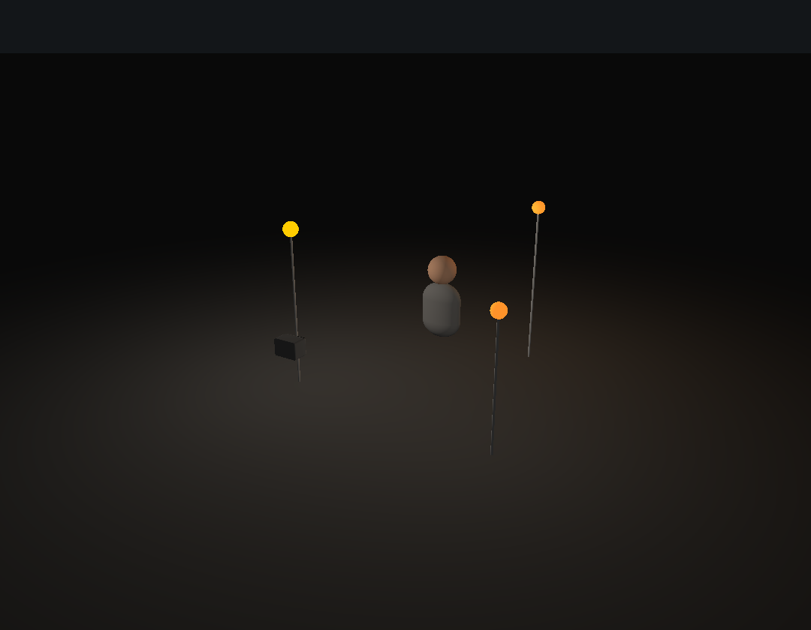
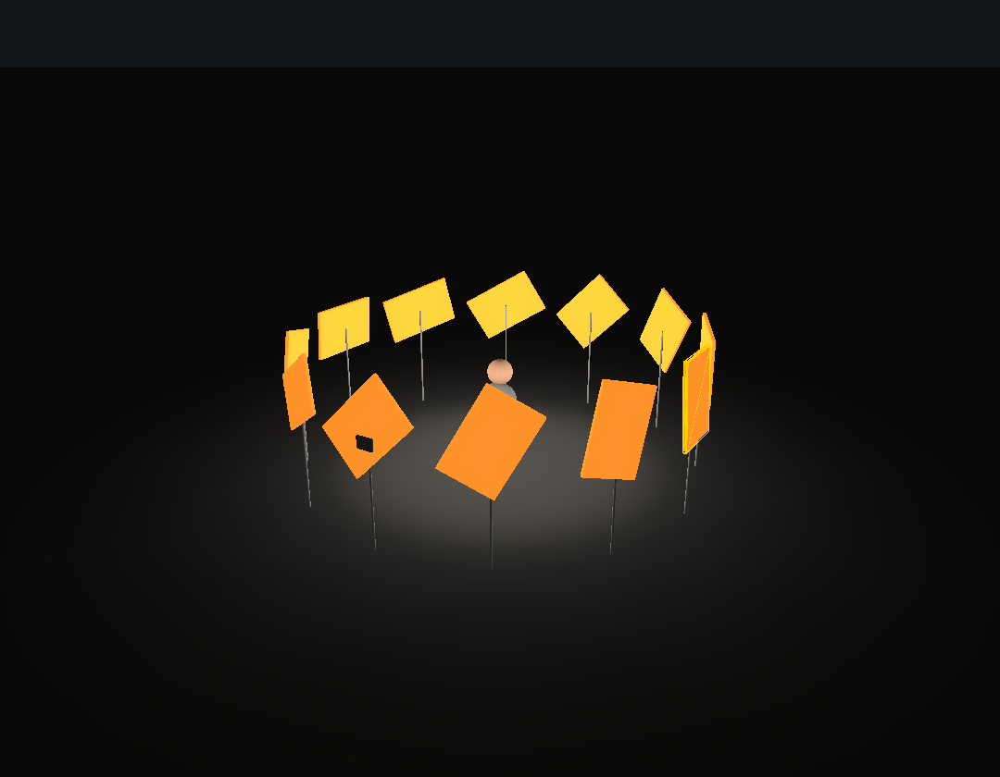

# Native checkpoint: 9725fb1

Source: `9725fb1177a5c7afbdf798ffd627e65e604c75b1`.

[Workflow run 45826141504](https://github.com/mirzotipi-wq/APP1/actions/runs/45826141504), simulator job139935031405, completed successfully. Raw bytes are preserved in native-9725fb1.log.

- Debug test-bundle and Release app builds passed.
- 176 native methods passed. The execution gate verified exactly one start and one pass for every method, with no failures, skips, duplicates or omissions.
- All30 spatial methods passed: SpatialEmitterGeometryTests5, SpatialEntityUpdateTests3, SpatialInteractionTests9, SpatialPreviewTests3 and SpatialViewportStateTests10.
- This verifies the five methods added after the171-method checkpoint, including far clipping, aim-marker bounds and same-UUID modifier/stand transitions.
- Core job139932802694 passed366Debug and366Release package methods plus100tooling checks; its raw log is core-9725fb1.log.
- Original SceneKit snapshots were retrieved from artifact15123617978. The ZIP digest f8ab287feef6219d284dbe5c550714cceb9c7e88df1909ad77394d1ef3045a27 was verified, and both originals were visually inspected. See ../captures/receipt-9725fb1.json.

These are actual SCNView snapshots in a UIWindow during XCTest, not manual gesture, RealityKit, physical-device or VoiceOver evidence. The ordinary and crowded rigs fit; the crowded panels obscure portions of the bust naturally. Dark floor contrast and small camera-body readability remain visual limitations.

## Other jobs and later source

The library-reference and studio-optics UI shards passed. App-accessibility failed at StudioAppAccessibilityUITests.swift:263 while waiting for a UI condition; this remains an owner investigation, not an established viewport cause. Room-precision and studio-export were cancelled when source4e694bc superseded this run after native execution had completed. Default visual attachment inventory passed; AXXXL inventory failed. These inventory results do not establish visual quality or VoiceOver acceptance. Exact final job dispositions are preserved in run-9725fb1-final-jobs.json.

The subsequent four camera-recovery methods, three selection-lifetime methods, one emitter-recovery method and rectangle diffuser-scale correction are outside this source SHA and remain unexecuted until their own checkpoint runs. RealityKit dimensions have source/scalar evidence only.
